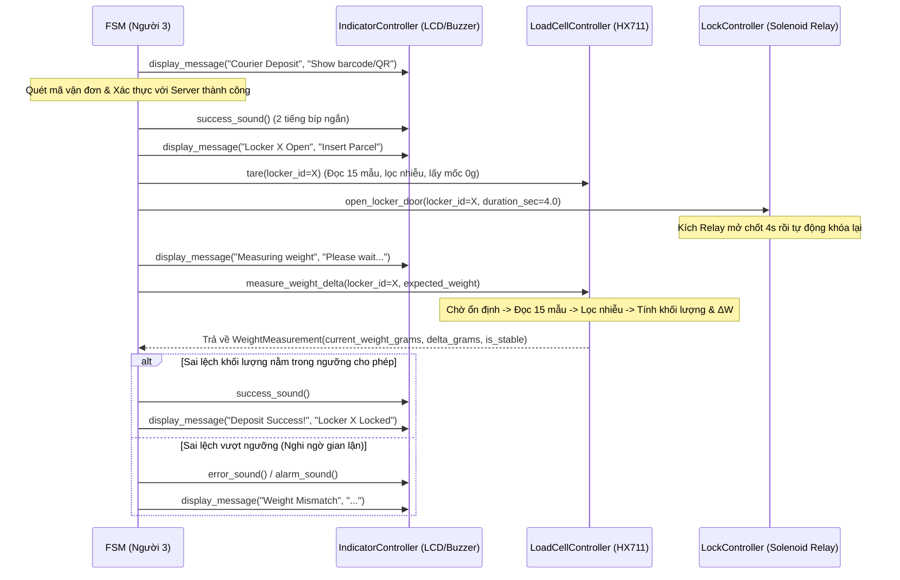

# 🔧 Module Phần cứng & Cảm biến (`edge/hardware/`) — Người 2

Tài liệu này ghi chú toàn bộ nội dung công việc, các bản cập nhật, kiến trúc luồng hoạt động, giải thích thuật toán cốt lõi và hướng dẫn kiểm thử cho phân hệ **Hardware & Actuators (Người 2)** trên **Raspberry Pi 4B**.

---

## 📌 1. Tổng quan công việc & Những gì đã hoàn thiện (Changelog)

### Trách nhiệm chính
Phụ trách giao tiếp tầng vật lý (GPIO, I2C) trên Raspberry Pi 4B, bao gồm:
1. Đọc cảm biến tải trọng **Load Cell + mạch khuếch đại ADC 24-bit HX711**, lọc nhiễu tín hiệu và tính độ chênh lệch khối lượng ($\Delta W$).
2. Điều khiển **động cơ Servo (SG90 / MG90S / MG996R)** bằng tín hiệu xung PWM (50Hz) gạt chốt khóa / mở cửa tủ cho 3 ngăn tủ.
3. Điều khiển **còi Buzzer** phát âm thanh phản hồi/báo động và hiển thị trạng thái lên **màn hình LCD 1602 (giao tiếp I2C)**.
4. Cung cấp các hàm và lớp đúng **Giao ước bàn giao (Contract)** cho **Người 3 (`edge/core/fsm.py`)**.

### Các nâng cấp & hoàn thiện đã thực hiện
* **`hx711_loadcell.py`**:
  * Nâng cấp từ đọc 1 mẫu thô sang **đọc đa mẫu (`DEFAULT_SAMPLE_COUNT = 15`)** kết hợp thuật toán **lọc nhiễu Trimmed Mean / Median (`filter_samples`)** giúp cắt bỏ 20% xung nhiễu thấp nhất và 20% xung nhiễu cao nhất (loại bỏ hoàn toàn hiện tượng nhảy số/spike của HX711).
  * Bổ sung tính **độ lệch chuẩn ($\sigma$)** quy đổi ra gram để tự động đánh giá trạng thái ổn định của mâm cân (`is_stable = True` khi $\sigma \le 5.0\text{g}$).
  * Tính toán chính xác độ biến thiên khối lượng $\Delta W$ (`delta_grams = current_weight - previous_weight`) qua từng lần đặt/lấy hàng, cả ở chế độ thật và chế độ giả lập (`MOCK_HARDWARE`).
  * Cung cấp cả phương thức trong class `LoadCellController` lẫn hàm tiện ích cấp module `measure_weight_delta()` đúng theo Contract.
* **`indicators.py`**:
  * Viết hoàn chỉnh trình điều khiển **HD44780 ở chế độ 4-bit qua chip mở rộng I2C PCF8574 (`smbus2`)**: khởi tạo màn hình (`_init_lcd`), tách byte thành 2 nibble cao/thấp (`_write_byte`), chốt xung `ENABLE` (`_toggle_enable`), ghi ký tự ra dòng 1 (`0x80`) và dòng 2 (`0xC0`), xóa màn hình (`clear`) và bật/tắt đèn nền (`set_backlight`).
  * Bổ sung hàm hú còi báo động liên thanh `alarm_sound()` (dùng khi phát hiện sai lệch khối lượng hoặc cạy tủ) bên cạnh `beep()`, `success_sound()`, `error_sound()` và hàm dọn dẹp an toàn `cleanup()`.
* **`lock_controller.py`**:
  * Cải tiến điều khiển Relay Solenoid với cơ chế khóa an toàn trong khối `try...finally` (đảm bảo cuộn hút Solenoid luôn được ngắt điện sau `duration_sec`, chống quá nhiệt/cháy khóa).
  * Bổ sung hàm `lock_all()`, `cleanup()` và hàm cấp module `open_locker_door()` theo đúng Contract.
* **`__init__.py` & `tests/test_edge_contracts.py`**:
  * Export đầy đủ `LoadCellController`, `LockController`, `IndicatorController`, `measure_weight_delta`, `open_locker_door`.
  * Bổ sung bộ kiểm thử tự động kiểm tra thuật toán lọc nhiễu HX711, tính toán $\Delta W$, giao tiếp I2C giả lập và kiểm tra tính tương thích Contract.

---

## 📂 2. Cấu trúc thư mục & Sơ đồ chân phần cứng (Pinout Mapping)

### Cấu trúc file trong `edge/hardware/`
```text
edge/
├── config.py                  # Khai báo chân GPIO (BCM), địa chỉ I2C, hằng số hiệu chuẩn cân
└── hardware/                  # [THƯ MỤC CỦA NGƯỜI 2]
    ├── __init__.py            # Điểm xuất (Export) các class & hàm Contract cho Người 3
    ├── README.md              # Tài liệu hướng dẫn & ghi chú kỹ thuật (file này)
    ├── hx711_loadcell.py      # Đọc cảm biến HX711, lọc nhiễu Trimmed Mean & tính ΔW
    ├── lock_controller.py     # Điều khiển Relay đóng/mở chốt khóa điện từ Solenoid
    └── indicators.py          # Điều khiển còi Buzzer & màn hình LCD 1602 (I2C PCF8574)
```

### Bảng đấu nối chân trên Raspberry Pi 4B (Theo chuẩn đánh số BCM trong `edge/config.py`)

> 📘 **Xem hướng dẫn chi tiết từng chân Vật lý (Pin 1–40), Keypad 4x4 (`S1`–`S16`), Camera CSI, nguồn ngoài Servo và các lệnh test độc lập tại [`HARDWARE_GUIDE.md`](../../HARDWARE_GUIDE.md).**

| Linh kiện | Chân tín hiệu | Chân Raspberry Pi (BCM) | Ghi chú cấu hình |
| :--- | :--- | :--- | :--- |
| **HX711 Load Cell** | `DT` (Data) | `GPIO 5` | Input (Đọc xung dữ liệu 24-bit) |
| **HX711 Load Cell** | `SCK` (Clock) | `GPIO 6` | Output (Phát xung nhịp đọc bit & chọn Gain 128) |
| **Servo Ngăn 1 (Vàng/Cam)** | `Signal (PWM)` | `GPIO 17` | Output (PWM 50Hz, 0° = Khóa, 90° = Mở) |
| **Servo Ngăn 2 (Vàng/Cam)** | `Signal (PWM)` | `GPIO 27` | Output (PWM 50Hz, 0° = Khóa, 90° = Mở) |
| **Servo Ngăn 3 (Vàng/Cam)** | `Signal (PWM)` | `GPIO 22` | Output (PWM 50Hz, 0° = Khóa, 90° = Mở) |
| **Còi báo Buzzer** | `I/O (+)` | `GPIO 26` | Output (`BUZZER_ACTIVE_HIGH = True`, kích mức `HIGH`) |
| **Màn hình LCD 1602 I2C** | `SDA` / `SCL` | `GPIO 2 (SDA)` / `GPIO 3 (SCL)` | Bus I2C số `1` (`LCD_I2C_BUS = 1`), Địa chỉ `0x27` |

---

## 🔄 3. Luồng hoạt động chi tiết (Workflow)

Các thành phần phần cứng trong `edge/hardware/` được điều phối bởi Máy trạng thái hữu hạn (`LockerStateMachine` trong `edge/core/fsm.py` của Người 3) qua 2 kịch bản chính:

### Kịch bản 1: Shipper gửi hàng vào tủ (Courier Deposit)


### Kịch bản 2: Người nhận lấy hàng bằng mã OTP (Recipient Pickup)
1. `fsm` gọi `indicators.display_message("Enter 6-digit OTP", "Press # to enter")`.
2. Sau khi người dùng bấm phím và Server xác nhận OTP đúng:
   * `fsm` gọi `indicators.success_sound()` và `indicators.display_message("Locker X Open", "Take Your Parcel")`.
   * `fsm` gọi `lock.open_locker_door(locker_id=X)` để bung cửa tủ cho khách lấy hàng.
3. Nếu nhập sai OTP quá 3 lần: gọi `indicators.error_sound()` và hiển thị thời gian khóa bàn phím lên LCD.

---

## 🧠 4. Giải thích các đoạn code & thuật toán quan trọng

### 4.1. Đọc xung 24-bit từ HX711 (`_read_raw_hx711` trong `hx711_loadcell.py`)
Chip HX711 không dùng I2C hay SPI chuẩn mà dùng giao thức nối tiếp 2 dây (`DT` và `SCK`):
* Khi HX711 sẵn sàng trả dữ liệu, chân `DT` kéo xuống mức `0` (`LOW`).
* Raspberry Pi phát **24 xung nhịp `SCK`** (kéo lên `HIGH` rồi xuống `LOW`), mỗi xung dịch trái biến `count` (`count << 1`) và đọc 1 bit từ chân `DT` (từ MSB đến LSB).
* Phát thêm **xung thứ 25** trên chân `SCK` để cấu hình HX711 chọn **Kênh A, độ lợi (Gain) = 128** cho lần đo kế tiếp.
* Do giá trị 24-bit của HX711 ở dạng **bù 2 (2's complement)**, nếu bit dấu thứ 24 bật (`count & 0x800000`), ta trừ đi `0x1000000` để nhận về số nguyên có dấu chính xác.

### 4.2. Thuật toán lọc nhiễu Trimmed Mean & Kiểm tra ổn định (`filter_samples`)
Mạch Load Cell rất nhạy với rung động cơ học và nhiễu nguồn điện (đôi khi vọt lên giá trị cực đại hoặc cực tiểu). Nếu chỉ lấy trung bình cộng thông thường, 1 mẫu nhiễu sẽ làm sai lệch toàn bộ kết quả.
* **Cách giải quyết trong `filter_samples(samples, trim_ratio=0.2)`**:
  1. Thu thập $N = 15$ mẫu liên tiếp (`sorted_samples = sorted(valid)`).
  2. Cắt bỏ $20\%$ mẫu nhỏ nhất ở đầu mảng và $20\%$ mẫu lớn nhất ở cuối mảng (`trimmed = sorted_samples[trim_count : n - trim_count]`).
  3. Tính trung bình cộng (`mean_val`) và độ lệch chuẩn (`std_dev`) trên $60\%$ mẫu sạch ở giữa.
* **Quy đổi ra Gram và tính $\Delta W$ trong `measure_weight_delta()`**:
  $$\text{weight\_g} = \max\left(0.0, \frac{\text{filtered\_raw} - \text{tare\_offset}}{\text{calibration\_factor}}\right)$$
  $$\Delta W = \text{weight\_g} - \text{previous\_weight}$$
  $$\text{is\_stable} = \left|\frac{\text{raw\_std\_dev}}{\text{calibration\_factor}}\right| \le 5.0\text{ g}$$

### 4.3. Bảo vệ an toàn khóa điện từ Solenoid (`open_locker_door` trong `lock_controller.py`)
Khóa chốt điện từ Solenoid 12V tiêu thụ dòng lớn và tỏa nhiệt rất nhanh nếu bị cấp điện liên tục. Do đó, hàm `open_locker_door()` sử dụng cấu trúc `try ... finally`:
```python
unlock_state = GPIO.LOW if RELAY_ACTIVE_LOW else GPIO.HIGH
lock_state = GPIO.HIGH if RELAY_ACTIVE_LOW else GPIO.LOW

try:
    GPIO.output(pin, unlock_state)
    self.door_status[locker_id] = False
    time.sleep(max(0.1, duration_sec))
finally:
    GPIO.output(pin, lock_state)
    self.door_status[locker_id] = True
```
Dù có xảy ra ngoại lệ hay ngắt chương trình (`KeyboardInterrupt`) trong lúc đang chờ `time.sleep()`, khối `finally` **luôn luôn chạy** để đưa chân GPIO về `lock_state` (ngắt Relay), bảo vệ phần cứng tuyệt đối.

### 4.4. Giao thức I2C 4-bit cho màn hình LCD 1602 (`indicators.py`)
Màn hình LCD 1602 gắn module chuyển đổi I2C PCF8574 chỉ có 8 chân dữ liệu mở rộng (`P0..P7`), trong đó:
* `P0 (0x01)`: Chân `RS` (`0` = Gửi lệnh điều khiển `LCD_CMD`, `1` = Gửi ký tự hiển thị `LCD_CHR`).
* `P2 (0x04)`: Chân `ENABLE` (`LCD_ENABLE` — tạo xung sườn xuống để LCD chốt dữ liệu).
* `P3 (0x08)`: Đèn nền `LCD_BACKLIGHT`.
* `P4..P7`: 4 đường dữ liệu `D4..D7`.

Vì chỉ có 4 đường dữ liệu, hàm `_write_byte(bits, mode)` phải chia mỗi byte (8-bit) thành **2 lần gửi (4-bit cao `bits & 0xF0` trước, 4-bit thấp `(bits << 4) & 0xF0` sau)**, mỗi lần đều kèm theo cờ đèn nền và gọi `_toggle_enable()` để chốt dữ liệu vào chip HD44780.

---

## 🤝 5. Giao ước bàn giao (Contract) cho Người 3

Người 3 (`edge/core/fsm.py`) có thể gọi qua đối tượng class hoặc gọi trực tiếp hàm từ `edge.hardware`:

```python
from edge.hardware import (
    LoadCellController,
    LockController,
    IndicatorController,
    open_locker_door,
    measure_weight_delta,
)
```

1. **`open_locker_door(locker_id: int, duration_sec: float = 4.0) -> bool`**
   * Mở khóa ngăn tủ số `locker_id` (`1`, `2`, hoặc `3`) trong `duration_sec` giây. Trả về `True` nếu thành công, `False` nếu `locker_id` không hợp lệ.
2. **`measure_weight_delta(locker_id: int = 1, expected_weight: Optional[float] = None) -> WeightMeasurement`**
   * Trả về đối tượng Pydantic `WeightMeasurement` (định nghĩa tại `contracts/schemas.py`):
     ```python
     WeightMeasurement(
         locker_id=1,
         current_weight_grams=455.0,
         delta_grams=455.0,
         is_stable=True,
         timestamp=datetime(...)
     )
     ```

---

## 🧪 6. Hướng dẫn Kiểm thử (Testing) & Hiệu chuẩn (Calibration)

> **Lưu ý:** Tất cả các lệnh dưới đây được chạy tại thư mục gốc của dự án (`Smart-Parcel-Locker/`). Khi chạy trên máy tính Windows/macOS không có thư viện `RPi.GPIO`, hệ thống tự động kích hoạt chế độ giả lập (`MOCK_HARDWARE = True`).

### 6.1. Chạy Unit Test & Kiểm tra Contract tự động
Kiểm tra toàn bộ thuật toán lọc nhiễu HX711, tính $\Delta W$, đóng/mở khóa, LCD I2C và Buzzer:
```powershell
python -m tests.test_edge_contracts
```
*(Hoặc dùng pytest: `python -m pytest tests/test_edge_contracts.py -v`)*.

### 6.2. Chạy kiểm thử luồng phần cứng độc lập (Không cần bật Server của Người 4)
Chạy lệnh một dòng dưới đây để mô phỏng trọn vẹn quá trình: **Hiển thị LCD $\rightarrow$ Trừ bì (`tare`) $\rightarrow$ Mở khóa ngăn 1 (`open_locker_door`) $\rightarrow$ Cân kiện hàng & Tính $\Delta W$ (`measure_weight_delta`) $\rightarrow$ Kêu còi thành công (`success_sound`)**:

```powershell
python -c "import logging; logging.basicConfig(level=logging.INFO); from edge.hardware import LoadCellController, LockController, IndicatorController; lc, lk, ind = LoadCellController(), LockController(), IndicatorController(); ind.display_message('Locker 1 Open', 'Insert Parcel'); lc.tare(1); lk.open_locker_door(1, 1.0); ind.display_message('Measuring weight', 'Please wait...'); w = lc.measure_weight_delta(1, expected_weight=450.0); ind.success_sound(); ind.display_message('Deposit Success!', f'Weight: {w.current_weight_grams}g'); print(w)"
```

### 6.3. Kiểm thử & Hiệu chuẩn trên mạch Raspberry Pi 4B thật
Khi đã đấu nối phần cứng trên Raspberry Pi 4B:

1. **Kiểm tra địa chỉ I2C của màn hình LCD 1602:**
   ```bash
   sudo i2cdetect -y 1
   ```
   Đảm bảo xuất hiện địa chỉ `27` (tương ứng `0x27` trong `edge/config.py`). Nếu hiện `3f`, cập nhật `LCD_I2C_ADDR = 0x3F` trong `edge/config.py`.

2. **Test nhanh LCD & Còi Buzzer trên mạch thật:**
   ```bash
   python -c "from edge.hardware import IndicatorController; ind = IndicatorController(mock_mode=False); ind.success_sound(); ind.display_message('Hello Pi 4B!', 'Hardware Ready')"
   ```

3. **Test nhanh Relay Khóa Solenoid trên mạch thật:**
   ```bash
   python -c "from edge.hardware import open_locker_door; open_locker_door(locker_id=1, duration_sec=3.0)"
   ```

4. **Cách hiệu chuẩn hệ số cân (`LOADCELL_CALIBRATION_FACTOR`):**
   * Chạy lệnh trừ bì khi mâm cân trống, sau đó đặt một vật chuẩn đã biết trước khối lượng thực tế (ví dụ quả cân hoặc chai nước $W_{\text{thực}} = 500\text{ g}$):
     ```bash
     python -c "from edge.hardware import LoadCellController; lc = LoadCellController(mock_mode=False); lc.tare(1); input('Dat vat chuan 500g len can roi nhan Enter...'); print(lc.measure_weight_delta(1))"
     ```
   * Nếu kết quả in ra là $W_{\text{đo}}$, cập nhật lại `LOADCELL_CALIBRATION_FACTOR` trong `edge/config.py` theo công thức:
     $$\text{LOADCELL\_CALIBRATION\_FACTOR mới} = \text{LOADCELL\_CALIBRATION\_FACTOR cũ} \times \frac{W_{\text{đo}}}{W_{\text{thực}}}$$

